<a href="https://phuongddx.cc">
  <picture>
    <source media="(prefers-color-scheme: dark)" srcset="assets/hero-dark.svg">
    
  </picture>
</a>

# AI engineer building code intelligence for coding agents

I have shipped production software for more than six years, first iOS apps and now LLM and
retrieval systems end to end. The parts that decide whether an AI system works in production
are the boring ones: chunking and embedding strategy, gateway design with SSE streaming and
fallback chains, agent observability, and the packaging that ships it. I build the boring ones.

**[Read my portfolio](https://phuongddx.cc)** &nbsp;·&nbsp; [LinkedIn](https://linkedin.com/in/phuongddx) &nbsp;·&nbsp; [X](https://x.com/phuongddx) &nbsp;·&nbsp; [Email me](mailto:95doanphuong@gmail.com)

## jarvis, a code-intelligence MCP server

<a href="https://github.com/jarvis-intelligence/jarvis">
  
</a>

jarvis precomputes a local index so a coding agent stops spending its context window on grep.
It gives Claude Code, Cursor and Codex ten MCP tools: SCIP navigation (`goToDefinition`,
`findReferences`, `callHierarchy`, `typeHierarchy`), Zoekt lexical search, and semantic search,
with the result sets fused by reciprocal rank fusion.

Code is chunked along the tree-sitter AST (256 to 512 tokens, 50 overlap) and embeddings are
pinned to a revision. A new index is published atomically: `os.replace` flips one pointer, so
there is no downtime window. Code and indexes never leave your machine. Semantic search ships
in source builds only; the Homebrew binary leaves it out.

```bash
brew install jarvis-intelligence/jarvis/jarvis
```

[See the jarvis repo](https://github.com/jarvis-intelligence/jarvis) &nbsp;·&nbsp; [Get `jarvis-mcp` on PyPI](https://pypi.org/project/jarvis-mcp/) &nbsp;·&nbsp; [Find it in the MCP Registry](https://registry.modelcontextprotocol.io/)

`Python` `LanceDB` `tree-sitter` `SCIP` `Zoekt`

## StressMonitor, a stress score for iPhone and Apple Watch

<p align="center">
  <a href="https://github.com/phuongddx/stress-coach-ios">
    
    &nbsp;
    
    &nbsp;
    
  </a>
</p>

A privacy-first stress score for iOS, with a standalone watch app. Five factors feed the score;
when a signal is missing its weight moves to the others, and each factor carries its own
confidence. An AI coach streams its replies over SSE, and raw health samples never enter the
model path. Widgets, complications, CloudKit sync and StoreKit subscriptions are in the build.

[See the StressMonitor repo](https://github.com/phuongddx/stress-coach-ios)

`SwiftUI` `watchOS` `HealthKit` `StoreKit`

## Tools for Swift and LLM teams

**[scip-swift](https://github.com/jarvis-intelligence/scip-swift)** &nbsp; `Swift` `SourceKit-LSP`<br>
A SCIP indexer for Swift. It brings go-to-definition, find-references and type-hierarchy
navigation to Apple-platform codebases, with prebuilt binaries from a Homebrew tap.

**[llm-gateway](https://github.com/phuongddx/llm-gateway)** &nbsp; `FastAPI` `SSE` `SQLite`<br>
An OpenAI-compatible gateway (`/v1/chat/completions`) that routes 500+ models behind one key,
with `model="auto"` routing and passthrough for unknown names. It logs time to first token,
end-to-end latency and token usage for every request, so model choice rests on a measurement.

**[BoosterSimApp](https://github.com/phuongddx/BoosterSimApp)** &nbsp; `Swift` `AppKit` `ScreenCaptureKit`<br>
A macOS menu-bar companion for the iOS Simulator: a floating side panel that follows the
Simulator window, screenshots and recording with App Store Connect presets, 8pt-grid and
safe-area overlays, a live accessibility-tree inspector and network throttling. It ships as a
notarized DMG with Sparkle updates, and its `boostersim` CLI lets AI agents drive the simulator.

**[spm-cache](https://github.com/phuongddx/spm-cache)** &nbsp; `Ruby` `SPM` `GitHub Actions`<br>
A cache proxy for Swift Package Manager that serves prebuilt xcframeworks. Install it from a
[Homebrew tap](https://github.com/phuongddx/homebrew-spm-cache) and wire it into CI with a
[GitHub Action](https://github.com/phuongddx/spm-cache-action).

## Upstream contributions

- **[OmniRoute](https://github.com/diegosouzapw/OmniRoute)**, an MIT-licensed AI gateway in front of 290+ providers: SSE streaming for GLM-5.3 effort tiers ([#11415](https://github.com/diegosouzapw/OmniRoute/pull/11415)).
- **[scip-code/scip](https://github.com/scip-code/scip)**: the `global_symbols.relationships` fix that makes `typeHierarchy` resolve ([#465](https://github.com/scip-code/scip/pull/465)).

## Toolbox

| | |
|---|---|
| **AI and agents** | MCP servers, tool calling, RAG and hybrid search (dense, lexical and symbol, fused by RRF), embeddings (`bge-m3`, `e5`, `nomic`), SSE streaming, model routing and fallback chains, agent observability and tracing |
| **Backend and data** | Python (FastAPI), TypeScript (Deno/Hono, Next.js), PostgreSQL (RLS, `pg_cron`), SQLite, LanceDB, Supabase, Redis, Docker, GitHub Actions |
| **Shipping** | PyPI trusted publishing, cibuildwheel, Homebrew taps, Fastlane to TestFlight, Vercel, Render, Dokploy |
| **Mobile** | Swift, SwiftUI, UIKit, watchOS, HealthKit, StoreKit, React Native and Expo |

I am learning Go at the moment. Ask me about MCP servers, hybrid retrieval and RRF, tree-sitter
chunking, SSE gateways, or shipping iOS and watchOS apps.

**[Read my portfolio](https://phuongddx.cc)** &nbsp;·&nbsp; [Email me](mailto:95doanphuong@gmail.com)
